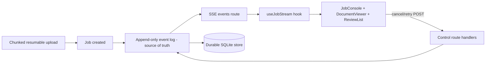

# Sarvam Staff Frontend - System Design Self-Study Plan

A 2-week, study-only prep plan for the **Staff Software Engineer - Frontend** role at Sarvam AI. No new code - this is an interview artifact. It uses the **AI Document Intelligence Console** (this repo) as the running case study, maps the JD to concrete evidence, schedules a course-driven curriculum, and drills mock questions.

- **Timeline:** 2 weeks intensive (~4-6 hrs/day).
- **Mode:** study + mock interviews only.
- **Spine:** Master.dev [Front-End System Design](https://master.dev/courses/frontend-system-design/) (Evgenii Ray, 4h37m).
- **Supplements:** other Master.dev courses (full access) + Fanout System Design (Complete access).

Contents:
1. [How to answer a frontend system design question](#1-how-to-answer-a-frontend-system-design-question)
2. [JD -> project evidence map](#2-jd---project-evidence-map)
3. [Core mental-model cheat sheets](#3-core-mental-model-cheat-sheets)
4. [The 14-day schedule](#4-the-14-day-schedule)
5. [Mock question bank](#5-mock-question-bank)
6. [Project narrative one-pager](#6-project-narrative-one-pager)
7. [Gap-topic primers](#7-gap-topic-primers)
8. [Resource index](#8-resource-index)

---

## 1. How to answer a frontend system design question

A repeatable 9-step frame. Spend the first ~5 minutes on steps 1-2; interviewers grade you on driving the conversation, naming trade-offs, and closing loops - not on trivia.

1. **Clarify & scope.** Restate the prompt. Split functional vs non-functional requirements. Ask: who are the users, what's the primary flow, what's explicitly out of scope. Write requirements on the board.
2. **Constraints & scale.** Numbers: concurrent users, payload sizes, event rates, latency targets, device/network profile (mobile, flaky), read vs write ratio. These numbers justify every later decision.
3. **Data model & API.** Define the client-facing entities and the shape of the contract. Choose transport (REST / GraphQL / SSE / WebSocket / polling) and justify it against step 2. Define pagination (cursor vs offset) and the event/update contract.
4. **Component & state architecture.** Draw the component tree and the state layers: server cache, client/UI state, URL state, ephemeral. Name the state library or pattern and why. Show data flow.
5. **Real-time / async.** How updates arrive, how the UI reconciles them, ordering, reconnection/replay, backpressure. For long-running work: how progress, partial results, retries, and failures render.
6. **Failure & partial results.** What the UI shows on error, timeout, degraded/partial data, offline. Idempotency, optimistic updates + rollback, retry/backoff, "stale but usable" states.
7. **Performance.** Loading (code splitting, streaming SSR/RSC, prefetch), rendering (virtualization, memoization), network (caching, batching), memory, bundle size. Tie each to a Core Web Vital (LCP/INP/CLS).
8. **Observability & rollout.** Metrics, structured logs, traces, error tracking, correlation ids, RUM. Feature flags, canary, testing strategy.
9. **Trade-offs & follow-ups.** Summarize the 2-3 decisions that mattered, state what you'd revisit at 10x scale, and name what you deliberately left out.

**Time-box (45 min):** 5 clarify/scale, 10 data+API+components, 10 real-time+failure, 10 performance, 5 observability/rollout, 5 wrap-up/trade-offs.

---

## 2. JD -> project evidence map

Every JD requirement, where this repo already proves it, and the honest gap. Use the left column as interview claims and the middle column as your evidence.

| JD requirement | Evidence in this project | Honest gap to study |
| --- | --- | --- |
| Real-time interactions, streaming, continuously changing UI | `src/jobs/useJobStream` (SSE hook) + `app/api/jobs/[id]/events` over an append-only log; `Last-Event-ID` reconnect/replay | Bidirectional WebSockets; horizontal fan-out of connections at scale |
| Long-running tasks, tool calls, partial results | Append-only event log as source of truth; statuses `queued`/`processing`/`partially_completed`/`completed`/`failed`/`rejected`; `attempt` stamping; replay after restart (durable SQLite store, spec 0005) | Queue lag, DAG orchestration, distributed schedulers |
| Large files, progress, retries, failures | Chunked `init`/`chunk`/`complete` upload; `app/api/documents/[id]/file` byte streaming | Content-addressed dedupe, presigned direct-to-object-store upload |
| Responsive UI over large data / long operations | Virtualized `DocumentViewer` (`@tanstack/react-virtual`, `pdfjs-dist`) | Hand-rolled virtualization pool/recycling internals |
| Reliable UX around AI-generated responses | `ReviewList` over extracted fields with `confidence` + `sources`; mirrors the Sarvam Doc AI contract | Streaming token/tool-call surfaces |
| Web performance | Local `public/pdf.worker.min.mjs` (no CDN dep); RSC/App Router | Bundle/memory profiling discipline, Core Web Vitals budgets |
| Observability, production debugging | `src/telemetry` logs/spans + correlation ids (`request_id`, `job_id`, `document_id`) | Real error tracking (Sentry), distributed tracing (OTel), RUM backends |
| Testing, releases, feature flags, CI/CD | Vitest suite; `src/flags` typed flags; `.github/workflows/ci.yml` (lint->typecheck->format->test->build) | Canary/rollout strategy, visual/e2e testing |
| Shared components / design system / platform | `src/ui/` design-system primitives | Cross-team versioning, tokens, Storybook, adoption |
| System-design skills & trade-offs | Tracer-bullet build; specs in `docs/specs/` | Practice articulating at Staff altitude |
| Video/audio fundamentals & media workflows | **None** | **Biggest gap:** codecs/containers, HLS/DASH, MSE/WebCodecs, WebRTC, A/V sync, dubbing/waveform UIs |
| Document digitization workflows | The entire app models this | Sarvam specifics: 23 languages/scripts, i18n/RTL, ZIP/bulk, md/html output |
| Influence without authority, mentoring, ownership | n/a (solo project) | Staff behavioral stories |

**One-line honest gaps list:** media/audio, bidirectional WebSockets-at-scale, real observability backends, design-system/platform breadth, micro-frontend/multi-isolate scaling, i18n for Indic scripts, Staff behavioral framing.

---

## 3. Core mental-model cheat sheets

Memorize these. They are the reusable "atoms" you'll assemble in any answer.

### 3.1 Real-time transport chooser

| Option | Direction | Reconnect/replay | Use when | Cost |
| --- | --- | --- | --- | --- |
| Polling | client pull | trivial | low-frequency, simple | wasted requests |
| Long polling | client pull (held) | manual | legacy fallback | connection churn |
| **SSE** | server -> client | **built-in `Last-Event-ID`** | receive-only streams, text, battery-friendly | one-way only, ~6-conn HTTP/1.1 limit |
| **WebSocket** | bidirectional | manual (you build it) | client also sends (typing, cursors, control) | stateful, sticky sessions, infra cost |

Rule of thumb: **feed/status = SSE**; **collaboration/control = WebSocket**. This project uses SSE because the client only *receives* job events; control actions (cancel/retry) are plain POST. That separation ("stream is a disposable cursor; the event log is the source of truth") is a strong talking point.

### 3.2 Event-log / async job model

- **Append-only log = source of truth.** Every event carries a monotonic `id`. UI state is a projection of the log.
- **Reconnect = replay from `Last-Event-ID`.** No gaps; terminal event closes the stream.
- **Idempotency:** dedupe on event id / idempotency key so retries and worker crashes don't double-apply.
- **Retries:** stamp an `attempt` number; keep prior rows for audit. Backoff with jitter.
- **Partial results:** render what you have (`partially_completed`), flag degraded segments, keep retrying missing parts.
- **Progress:** derive `processed / total` from replayed events, not a separate mutable counter.

### 3.3 State layers

- **Server cache** (react-query/SWR/TanStack Query): remote data, invalidation, background refetch.
- **Client/UI state** (zustand/XState): local machine, optimistic updates, reconciliation.
- **URL state:** shareable/deep-linkable filters, selected entity.
- **Ephemeral:** hover, focus, transient inputs.
- Continuously-changing UI: model as a **state machine** (explicit states + transitions) to avoid impossible states; reconcile server events against optimistic local edits (last-writer-wins or merge with `updated_at`/version).

### 3.4 Performance levers (tie each to a metric)

- **LCP:** code splitting, streaming SSR/RSC, prefetch, image/font optimization (WEBP, `font-display`).
- **INP:** avoid long tasks, offload to workers, debounce, virtualize.
- **CLS:** reserve space, avoid layout shifts from late assets.
- **Network:** HTTP/2-3 multiplexing, batching, caching (`Cache-Control`, ETags), dedupe in-flight.
- **Memory:** virtualization + element recycling, drop offscreen data, avoid listener/closure leaks.
- **Bundle:** multi-chunk splitting, tree-shaking, minify/compress (brotli), defer non-critical, analyze with a bundle analyzer.

### 3.5 Rendering pipeline (from the course)

`DOM + CSSOM -> style -> layout(reflow) -> paint -> composite`. Transform/opacity animations can skip layout/paint and run on the **GPU** via composition layers (cheap); width/top/left changes force reflow (expensive). Batch DOM writes; use `DocumentFragment`/`<template>` to avoid intermediate reflows.

### 3.6 Media fundamentals (the gap)

- **Container vs codec:** MP4/WebM/HLS(.m3u8)/MPEG-DASH are containers/manifests; H.264/H.265/VP9/AV1 (video) and AAC/Opus (audio) are codecs.
- **Adaptive streaming:** HLS/DASH split media into segments at multiple bitrates; client (ABR) picks a rendition by bandwidth/buffer.
- **Browser APIs:** `<video>`/`<audio>`, **Media Source Extensions (MSE)** for custom buffering, **WebCodecs** for low-level encode/decode, **WebRTC** for sub-second live.
- **A/V sync:** presentation timestamps (PTS); keep audio master, slave video.
- **Dubbing/review UI:** waveform (Web Audio `AnalyserNode` / decoded PCM), transcript segments aligned to timecodes, per-segment edit + re-generate, scrubbing, region selection.

### 3.7 Observability

- **Three pillars:** metrics (aggregate), logs (structured, correlated), traces (causal spans).
- **Frontend-specific:** RUM (Core Web Vitals from real users), error tracking with source maps, correlation ids threaded client->server (this project: `request_id`/`job_id`/`document_id`).
- **SLOs & error budgets:** define user-centric SLIs (e.g., "job status visible within 2s of event"), budget, alert on burn rate.

---

## 4. The 14-day schedule

**Week 1 = the [Front-End System Design](https://master.dev/courses/frontend-system-design/) course, section by section (the spine).** Each day: watch the section, connect it to this project, then do the drill out loud.

- **Day 1 - Core Fundamentals.** Course: Introduction + Box Model, Formatting/Positioning, Reflow, Composition Layers, Browser Rendering. Tie-in: what makes `DocumentViewer` cheap/expensive to paint (transform vs layout). Drill: whiteboard how one CSS change flows style -> layout -> paint -> composite, and when it goes GPU.
- **Day 2 - DOM & Complex UI patterns.** Course: DOM API (query complexity, perf, templating) + Intersection/Mutation/Resize observers + infinite scroll. Tie-in: overlay + review interactions. Drill: implement infinite scroll and an observer-driven overlay from memory.
- **Day 3 - Virtualization.** Course: technique, from-scratch, pool, element recycling, top/bottom handling. Tie-in: why the viewer uses `@tanstack/react-virtual`; where a hand-rolled pool differs. Drill: design a virtualized 500-page PDF viewer with overlays.
- **Day 4 - State & Networking.** Course: IndexedDB/Session/Local trade-offs, normalization/indexes; TCP/UDP, long polling, SSE, WebSockets, REST vs GraphQL. Tie-in: `useJobStream` SSE + `job-state.ts` + `Last-Event-ID`. Drill: pick a transport for live job status; defend SSE vs WebSocket.
- **Day 5 - Web Performance.** Course: LCP/INP/CLS, HTTP/1.1->3, bundling/splitting/prefetch/minify, CSS/image/font optimization. Tie-in: a perf budget for the console. Drill: perf-optimize the console top to bottom.
- **Day 6 - The course mock.** Course: Systems Design Interview (Social Media News Feed) - study Evgenii's method (requirements -> state & API over SSE -> optimize network/render/JS). Then immediately RE-RUN the same prompt yourself, without watching. Drill: full news-feed mock, self-scored against his answer.
- **Day 7 - First domain mock + consolidate.** Full self-run mock on the **Sarvam doc-digitisation console** using the course's exact method. Self-review; build Week-1 cheat sheets (rendering, observers, virtualization, transports, perf).

**Week 2 = JD gap-fills only (what the course does NOT cover).**

- **Day 8 - Long-running jobs / partial results / retries.** (JD's #1 theme.) Fanout ch.08 (`Task queue vs event stream`, `Queue lag`, `DAG workflow orchestration`, `Fanout patterns`) + ch.02 (`Retries, timeouts, and idempotency`); case `18.02 Stripe idempotency keys`; walkthrough `15.07 Kafka-style log`, `16.01 notification system`. Tie-in: append-only log + `attempt`. Drill: async job-processing UI with failures/partial results/retry.
- **Day 9 - Doc-digitisation domain + i18n.** Sarvam product (23 languages/scripts, async job API, tables, md/html, ZIP/large files) + i18n/RTL (Urdu, Sindhi, Kashmiri), Indic font shaping, locale-aware review. Tie-in: whole project + `ReviewList`. Drill: design the Sarvam console end-to-end with i18n baked in.
- **Day 10 - Media/audio.** (Biggest gap.) Master.dev `Web Audio Synthesis & Visualization` (audio + waveform) + Fanout ch.13 (`Video transcoding pipeline`, `Adaptive bitrate and the CDN decider`, `Signed URLs, DRM, and video security`, `Live streaming, WebRTC, and latency`); walkthrough `17.02 video platform`. Plus codecs/containers, MSE/WebCodecs, A/V sync. Drill: design a dubbing/subtitle review UI.
- **Day 11 - Observability & production debugging.** Fanout ch.14 (`Observability for distributed systems`, `SLOs and error budgets`, `Incident response`); walkthrough `17.04 observability and SLOs (Datadog)`. Free fallbacks: OpenTelemetry, Sentry, web-vitals. Tie-in: `src/telemetry` correlation ids. Drill: design FE observability for an AI product.
- **Day 12 - Design systems / testing / releases.** Master.dev `Design Systems with Storybook, v2`, `Enterprise Design Systems Management`, `Enterprise UI Development: Microfrontends, Testing, & Code Quality`, `Testing Fundamentals`, `Enterprise Web App Accessibility (feat. React)`. Drill: design a shared component platform + release/flag strategy.
- **Day 13 - Scale & architecture trade-offs.** Master.dev `Frontend Architecture: Monoliths to Microfrontends` (Maxi Ferreira) + `TypeScript Monorepos`. Fanout ch.14 (`Multi-tenant design`, `Rate limiter placement and keys`, `Disaster recovery`); horizontal SSE/WS gateway scaling; serverless durability limits (this project's noted limit); cases `18.03 Discord`, `18.01 Instagram`. Drill.
- **Day 14 - Mocks + behavioral + narrative.** Two back-to-back mocks (doc digitisation + media/dubbing) + Staff behavioral via Master.dev `Senior Level Frontend Interview Prep` (influence without authority, ambiguous-problem ownership). Finalize the project-narrative one-pager (Section 6).

**Daily rhythm:** ~2h resource, ~1h project tie-in/notes, ~1-2h drill spoken aloud and self-scored against Section 1.

---

## 5. Mock question bank

12 prompts. For each: run the Section 1 frame. Model outlines are compressed - expand them on the board.

1. **Design Sarvam's document digitisation console.** Flow: upload (chunked/resumable) -> async job -> live status (SSE over event log) -> preview (virtualized viewer) -> extraction review/edit (confidence + sources) -> export (md/html). Non-functional: large/complex docs, 23 languages/RTL, partial results, restart durability. Trade-offs: SSE vs WS; event-log projection; virtualization; i18n.
2. **Live status stream for thousands of concurrent long-running jobs.** SSE per job vs one multiplexed stream; `Last-Event-ID` replay; server fan-out (pub/sub); connection limits (HTTP/1.1 6-conn cap -> HTTP/2 or a single multiplexed channel); backpressure; horizontal gateway sharded by job/user id.
3. **Browser resumable large-file upload.** Chunk + `init`/`chunk`/`complete`; content hashing for dedupe/integrity; presigned direct-to-object-store; parallel chunks with concurrency cap; resume via server-known offset; progress + retry/backoff; slow-network UX.
4. **Virtualized viewer for 500-page PDFs with overlays.** Windowing + element pool/recycling; absolute positioning for GPU; overlay layer synced to page transforms; lazy page decode via `pdfjs-dist` worker; memory ceiling; scroll-position stability on prepend.
5. **Review/editing over AI-extracted fields with confidence + sources.** Field model with `confidence`/`sources`/bounding box; overlay-to-field linking; optimistic edits + save; low-confidence surfacing; keyboard-first review; conflict handling on re-extraction.
6. **Audio/video dubbing review UI.** Waveform (decoded PCM / `AnalyserNode`); transcript segments aligned to timecodes; per-segment edit + re-generate (long-running job -> partial results); scrub/region select; A/V sync; large-media loading via MSE/HLS.
7. **Frontend observability for an AI product.** RUM (Web Vitals), error tracking + source maps, correlation ids threaded client->server, trace a request across job lifecycle, SLOs (e.g., status latency), dashboards + burn-rate alerts.
8. **Shared design system / component platform across teams.** Tokens -> primitives -> patterns; API design; versioning (semver + codemods); theming/a11y; Storybook as contract; adoption metrics; monorepo vs published packages.
9. **Streaming AI response surface (tokens + tool calls + partial results).** Token stream (SSE); render tool-call states; interleave partial results; cancel; reconnect/replay; optimistic UI + reconciliation; error/retry mid-stream.
10. **Partial failures / retries / degraded results in a long-running job UI.** Per-segment status; `partially_completed`; retry with `attempt` + backoff; idempotency; "stale but usable"; user-triggered retry vs auto; surfacing which parts failed.
11. **Cut bundle size and improve TTI on a heavy console.** Measure first (analyzer, Web Vitals); split routes/vendors; defer `pdfjs`/heavy libs; RSC/streaming SSR; prefetch on intent; image/font budget; remove dead deps.
12. **Feature-flag + canary release system for frontend.** Typed flags (`src/flags`), NEXT_PUBLIC exposure boundary, server vs client evaluation, gradual rollout by cohort, kill-switch, flag lifecycle/cleanup, testing both branches.

---

## 6. Project narrative one-pager

Your whiteboard story for "tell me about a system you built." Keep it to ~3 minutes.

**What:** An operator console for long-running document processing. Drop a document -> a job processes it -> the UI streams live status -> the operator reviews and approves extracted fields over a large virtualized document viewer.

**Architecture (draw this):**

**The five decisions that mattered:**
1. **Event log as source of truth**; the SSE stream is a disposable cursor. Reconnect replays from `Last-Event-ID` - no gaps, restart-durable.
2. **SSE (not WebSocket)** because the client only receives; control actions are plain POST. Simpler scaling, no sticky sessions.
3. **Durable SQLite store** so jobs/events/reviews survive a restart (spec 0005), with honest serverless best-effort caveats.
4. **Virtualized viewer** (`@tanstack/react-virtual` + `pdfjs-dist`) to render 500-page docs without blowing memory.
5. **Partial results + retries**: `attempt` stamping, `partially_completed` status, progress derived from replayed events.

**What I'd do at 10x:** multiplex per-job SSE into a sharded WebSocket/pub-sub gateway; move durability off single-process; add real tracing (OTel) + RUM; introduce i18n for Indic scripts.

**Honest limits (say them proactively):** single-process durability; mock extraction provider by default; no media pipeline yet.

---

## 7. Gap-topic primers

Short primers on the areas the course skips, so you're not blank on the board.

### 7.1 Media / audio-video (highest priority gap)
- Know container vs codec, HLS/DASH adaptive streaming + ABR, MSE vs WebCodecs vs WebRTC, and A/V sync via PTS (see 3.6).
- Dubbing workflow UI: transcript segments <-> timecodes, waveform, per-segment re-generate as a long-running job (reuse your event-log/partial-results model), scrub/region select.
- Scale: transcode pipeline server-side, deliver via CDN with signed URLs; client just plays adaptive renditions.

### 7.2 WebSockets at scale
- Stateful connections need sticky routing or a shared pub/sub (Redis/Kafka) so any gateway can deliver to any client.
- Shard gateways by user/job id; presence via TTL heartbeats; backpressure and message coalescing; fall back to SSE/polling.

### 7.3 Observability stack
- RUM + Web Vitals, error tracking with source maps, OTel traces threaded by correlation ids, structured logs. Define SLOs and alert on error-budget burn. This project already threads `request_id`/`job_id`/`document_id` - extend to a real backend.

### 7.4 Serverless durability & multi-isolate
- Per-isolate memory is ephemeral; durability must live in a shared store. Know the trade-off this project documents (single-process best-effort) and how you'd fix it (managed DB/object store, idempotent writes, replay).

### 7.5 i18n for Indic scripts (Sarvam-specific)
- 23 languages/scripts incl. RTL (Urdu, Sindhi, Kashmiri); complex shaping (Devanagari, Tamil, etc.); font subsetting per script; logical CSS properties; locale-aware number/date; bidi in mixed content; test with real script samples.

---

## 8. Resource index

**Spine (Week 1):** Master.dev [Front-End System Design](https://master.dev/courses/frontend-system-design/) (Evgenii Ray, 4h37m) - browser rendering, DOM API + perf, observers + infinite scroll, virtualization from scratch, state + storage, networking (TCP/UDP, long polling, SSE, WebSockets, REST/GraphQL), web performance (Core Web Vitals, HTTP/1-3, bundling, assets), full news-feed mock. Assessed: necessary but ~50% of a Staff loop.

**Supplement A - Master.dev (Week-2 gaps):**
- `Senior Level Frontend Interview Prep` (Evgenii Ray) - Staff behavioral + framing.
- `Frontend Architecture: Monoliths to Microfrontends` (Maxi Ferreira) - scale.
- `Enterprise UI Development: Microfrontends, Testing, & Code Quality` (Steve Kinney).
- `State Management at Scale in React & Next.js` (David Khourshid / XState).
- `React Performance, v2`, `Web Performance Fundamentals, v2`, `Intermediate React, v6: RSCs, Hooks, & Performance`, `Mastering Chrome Developer Tools, v4`.
- `Complete Intro to Real-Time` (Brian Holt), `Rx.js Fundamentals`, `JavaScript in the Background` (Firtman).
- `Web Audio Synthesis & Visualization` (Matt DesLauriers) - media/audio.
- `Design Systems with Storybook, v2`, `Enterprise Design Systems Management`, `Testing Fundamentals`, `Enterprise Web App Accessibility (feat. React)`, `TypeScript Monorepos`.
- `Backend System Design` (Jem Young) - skim, for the server side you integrate against.

**Supplement B - Fanout System Design (Complete access)** [systems depth]. Priority chapters:
- 02 APIs, services and protocols: API design contracts; HTTP/REST/gRPC; TCP vs UDP; Event contracts; Retries, timeouts, idempotency; Batching; Backpressure; Tail latency; Load shedding.
- 08 Async work and streams: Task queue vs event stream; Event bus; Queue lag; Distributed task scheduler; SKIP LOCKED work queue; DAG workflow orchestration; Fanout patterns.
- 11 Realtime, social and feeds: WebSockets vs SSE vs long polling; Realtime DB and WebSocket scaling; Feed generation push/pull/hybrid; newly-unread indicator; live commentary.
- 13 Media, files and CDN: Direct-to-object-storage upload; Video upload (signed URLs, multipart); Video transcoding pipeline; Adaptive bitrate and the CDN decider; Signed URLs/DRM; Live streaming/WebRTC/latency; Fixed-block chunking; Remote file sync.
- 14 Reliability and operations: Observability; SLOs and error budgets; Incident response; Deployment/migration safety; Data retention/privacy; Rate limiter placement; Sliding window rate limiter; Multi-tenant design; Disaster recovery.
- Walkthroughs/cases: 15.05 collaborative editor, 15.06 object store (S3), 15.07 Kafka-style log, 16.01 notification system, 16.06 chat, 17.02 video platform, 17.03 file sync (Dropbox), 17.04 observability and SLOs (Datadog); cases 18.01 Instagram, 18.02 Stripe idempotency keys, 18.03 Discord messages at scale, 18.04 Dynamo paper.
- Also: Fanout Labs (interactive), roadmaps, Knowledge Topography, daily papers.

**Free public fallbacks (offline-friendly):**
- MDN + web.dev (rendering, Web Vitals, observers, MSE, WebCodecs, SSE, WebSocket).
- OpenTelemetry docs, Sentry docs, `web-vitals` library (observability).
- HLS.js / Shaka Player docs (adaptive streaming).
- Sarvam [Document Digitisation API](https://www.sarvam.ai/apis/document-digitisation) (domain).

---

_Study-only artifact. Not part of the application. Update as you complete days and refine mock answers._
